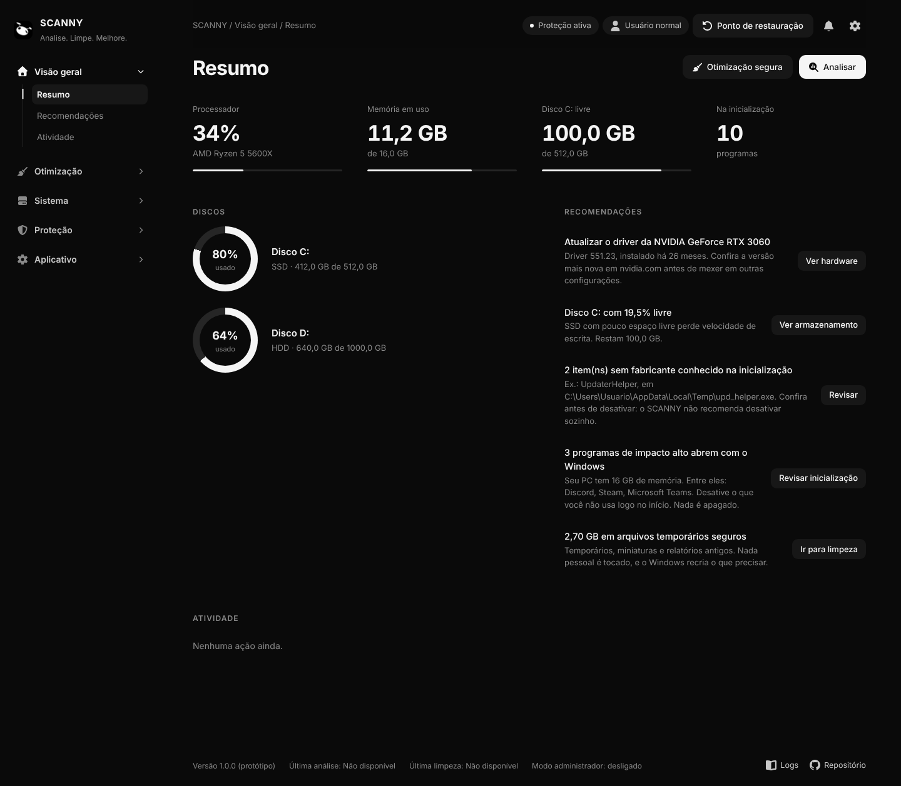

# SCANNY

**Analise. Limpe. Melhore.**

SCANNY é um protótipo de uma central leve e transparente para analisar, limpar e ajustar o Windows sem apagar arquivos pessoais ou desativar recursos importantes sem autorização.

> Atualmente, este repositório contém um **protótipo funcional de interface** em HTML, CSS e JavaScript puro. As operações de limpeza, reparo e otimização são simuladas para demonstrar os fluxos e a experiência do produto; elas ainda não executam alterações reais no Windows.



## O que existe neste repositório

- Interface responsiva com tema escuro e claro;
- Dashboard de visão geral;
- Telas de análise, limpeza, desempenho, inicialização, armazenamento, jogos, reparos, privacidade, segurança, histórico e configurações;
- Fluxos de confirmação, cancelamento, histórico e desfazer;
- Estado de dados de exemplo desligado por padrão;
- Dados de exemplo opcionais para apresentar a interface preenchida;
- Ícone do aplicativo;
- Testes automatizados Playwright;
- Prints da interface em `prints/`;
- Vídeos de demonstração em `video/`.

## Como executar

O protótipo não possui dependências de frontend. A forma mais simples é iniciar um servidor local na pasta `scanny-ui`:

```bash
cd scanny-ui
python3 -m http.server 4173
```

Depois abra <http://localhost:4173> no navegador.

Também é possível abrir `scanny-ui/index.html` diretamente, mas um servidor local é recomendado para uma experiência mais próxima da publicação.

## Testes

Com Python, Playwright e Chromium disponíveis:

```bash
pip install playwright
python3 testes/teste_scanny.py
```

O teste usa caminhos relativos ao próprio repositório e tenta utilizar `/usr/bin/chromium`. Para escolher outro executável:

```bash
CHROMIUM_PATH=/caminho/para/chromium python3 testes/teste_scanny.py
```

Os prints gerados pelos testes ficam em `prints-test/`, que é uma pasta local de validação e não precisa ser publicada.

## Estrutura

```text
scanny-ui/
├── index.html          casca do aplicativo
├── css/style.css       tokens, layout, temas e responsividade
├── js/data.js          dados de exemplo
├── js/icons.js         ícones SVG
├── js/ui.js            helpers de interface, modal, toast e persistência
├── js/views.js         telas do aplicativo
├── js/recomendacoes.js regras de recomendações
├── js/app.js           estado, roteamento e ações
└── assets/             ícones do aplicativo

prints/                 capturas de apresentação
video/                  demonstrações em MP4 e WebM
testes/                testes Playwright
```

## Segurança e limites atuais

O protótipo foi desenhado para não fingir que executou uma operação real. Com dados de exemplo desligados, informações indisponíveis são exibidas como **Não disponível**. A versão atual não:

- apaga arquivos reais;
- executa SFC, DISM ou comandos de rede;
- altera o registro do Windows;
- muda serviços ou planos de energia reais;
- desativa o Defender, Firewall ou Windows Update;
- encerra processos reais;
- envia telemetria própria.

A próxima etapa será criar uma camada nativa para Windows com permissões explícitas, prévia, backup, verificação e desfazer. Nenhuma função destrutiva deve ser adicionada sem esses controles.

## Mídia

- [Galeria de prints](prints/)
- [Vídeo MP4](video/scanny-demo.mp4)
- [Vídeo WebM](video/scanny-demo.webm)
- [Especificação detalhada](docs/SCANNY-especificacao-completa.md)

## Licença

O SCANNY é distribuído sob a licença MIT. O pacote de ícones Font Awesome Free usado pelo protótipo possui a licença indicada em `scanny-ui/README.md`.

## Contribuição

Leia `CONTRIBUTING.md` antes de abrir um pull request. Alterações que executem comandos no Windows devem incluir documentação do risco, caminho de restauração e testes.
